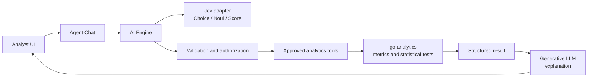
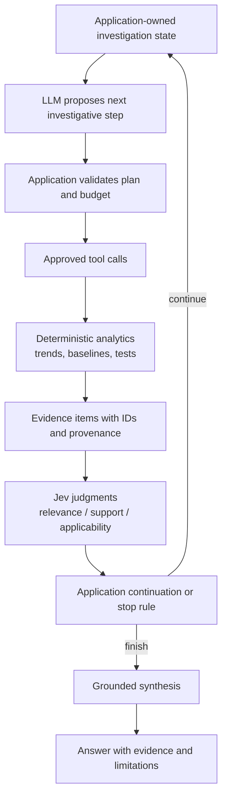

# Broadvoice AI Analyst: Jev use cases and architecture

This proposal uses the Broadvoice AI Analyst architecture context to identify where Jev can add a narrow, testable semantic decision, where deterministic code or a generative LLM remains the better fit, and how each use case connects to the application architecture.

The source context is [broadvoice_ai_analyst_architecture_context.md](<D:/code/jev apps/broadvoice_ai_analyst_architecture_context.md>). It describes the current capabilities, proposed horizons, and architect-review observations as separate categories. The examples below are illustrative; they do not assume that transcripts, workforce coverage, configuration data, or approved runbooks are available.

## Architecture at a glance

Initially, put the Jev adapter inside the AI Engine. It should accept relevant conversation or investigation state plus versioned, typed questions, and return judgments tied to candidate or evidence IDs along with provider metadata. Application code owns authorization, exact lookups, validation, thresholds, budgets, retries, state transitions, and stopping rules. Jev supplies narrow semantic judgments. The generative LLM handles open-ended planning and natural-language explanations. `go-analytics` owns KPI calculations, baselines, anomaly tests, attribution, sample adequacy, and statistical confidence.

Jev probability is confidence in a semantic judgment; it is not statistical confidence in an analytics result. A semantic support judgment does not establish causation. Grounding should combine exact checks in code with semantic checks, following TypeSafe’s [citation-verification pattern](https://docs.typesafe.ai/cookbooks/citation_check). Jev’s published [limitations](https://docs.typesafe.ai/model-jaggedness/jev-1.13) should inform evaluation and fallback behavior.

## 1. Request and analytics-tool routing

**Supervisor question:** “How many calls did the Phoenix queue handle last week, and what was its average wait time?”

**Data given to Jev:** The user’s utterance, the approved request-type and metric catalog, and the available tool descriptions. Do not pass hidden or unauthorized tools as candidates.

**Jev question and example outcome:** Use Choice to select one approved request family, such as `queue_metrics`, and Noul judgments to identify independently requested metrics: `call_volume` and `average_wait_time`. The exact typed output should include the request and metric IDs, not just generated labels.

**Where it fits:** In the AI Engine, before parameter validation and authorization. Application code resolves “Phoenix” to an authorized queue ID and “last week” to exact dates, then calls the existing analytics tool. The tool returns structured values; the LLM explains them.

**Why Jev fits:** Request type and metric intent are bounded choices, while multiple metrics can be requested together. Choice handles competing request/tool alternatives; separate Noul questions handle metrics that can coexist.

**Failure handling:** If no route is sufficiently likely, or multiple routes remain plausible, ask a clarifying question or use the existing fallback. Validate every selected tool and metric against an allowlist. Do not let a Jev judgment grant access.

**Worked example:** The route judgment selects `queue_metrics`. Code resolves queue `q-184` and dates `2026-09-28` through `2026-10-04`, checks access, and requests call volume and average wait. Analytics returns `12,480` calls and `74 seconds`. The LLM explains those values and their date range.

**Prefer code or an LLM when:** Use code for fixed syntax, exact metric formulas, and authorization. Use an LLM to interpret genuinely open-ended requests that need a new investigation plan, while retaining tool approval in code.

## 2. Entity and parameter resolution

**Supervisor question:** “Compare Northstar with North Star Support for September.”

**Data given to Jev:** The phrase, a list of candidate entities retrieved by an authorized directory lookup (IDs and descriptive metadata), plus the allowed parameter schema.

**Jev question and example outcome:** Choice selects the intended campaign or queue candidate from the supplied set, or returns `ambiguous`/`none`. It does not invent an entity ID. For this example, it may select candidate `campaign-42` for “Northstar” and `queue-17` for “North Star Support.”

**Where it fits:** After the application retrieves authorized candidates and before parameter validation. Code resolves the exact entity IDs and September’s date bounds, validates both, then calls existing analytics tools.

**Why Jev fits:** Matching a natural-language name to one of a small set of authorized candidates is a semantic choice; final lookup and validation remain deterministic.

**Failure handling:** If names are indistinguishable, ask which entity the supervisor means. Reject IDs not present in the candidate list. Treat missing dates or unsupported parameter values explicitly.

**Worked example:** The directory returns two Northstar campaigns and a queue named North Star Support. Jev chooses the campaign matching “Northstar” only if its metadata distinguishes it; otherwise code asks which campaign. Once resolved, code executes the comparison for September.

**Prefer code or an LLM when:** Code should normalize exact IDs, dates, and defaults. An LLM can help explain a complex request, but should not replace the authorized candidate lookup.

## 3. Follow-up interpretation

**Supervisor question:** “Which queue had the longest wait?” followed by “What about that one last month?”

**Data given to Jev:** The current utterance plus a compact, structured conversation state containing prior entities, dates, metrics, and the last result. Include only the state needed to interpret the reference.

**Jev question and example outcome:** Choice resolves “that one” to an entity in the structured state, or to `unresolved`. A separate Noul can judge whether the follow-up changes the investigation scope (for example, queue remains the subject while the date window changes).

**Where it fits:** In the AI Engine’s conversation interpretation step, before parameter validation. Code checks that the referenced entity remains authorized and resolves “last month” to exact dates.

**Why Jev fits:** Reference resolution depends on conversational meaning, while the actual state update and access checks are application responsibilities.

**Failure handling:** If state is missing, stale, or has several plausible antecedents, ask the user. Do not reuse a prior entity without rechecking authorization.

**Worked example:** The previous answer identified the “Phoenix Retention” queue as having the longest wait. Jev resolves “that one” to `queue-184`; code checks access and queries the prior calendar month. If the previous result named several queues, the application asks which one.

**Prefer code or an LLM when:** Code should store and version the conversation state. A generative LLM may be useful for complex multi-turn planning, but compact follow-up resolution can be an independently testable Jev judgment.

## 4. Generated-answer verification

**Supervisor question:** “Is this summary supported by the queue data?”

**Data given to Jev:** Each generated claim, its cited structured evidence IDs and excerpts, and the allowed outcomes `supported`, `contradicted`, or `insufficient_evidence`.

**Jev question and example outcome:** For a claim such as “Phoenix wait time improved by 20%,” Jev judges whether the cited evidence semantically supports that claim. It might return `contradicted` if the evidence describes a different queue or timeframe.

**Where it fits:** After answer generation and exact checks, before the application publishes the answer. Code checks numerical values, units, date ranges, and source references. Jev checks semantic alignment between claim and cited evidence. Application policy decides whether to publish, revise, or mark inconclusive.

**Why Jev fits:** Semantic entailment and relevance are distinct from exact arithmetic and source-ID validation.

**Failure handling:** Missing citations, conflicting evidence, or low-confidence judgments should block strong claims or produce an explicit inconclusive result. A semantic support judgment cannot validate causation.

**Worked example:** The answer says wait time decreased 20%. Code recomputes the percentage and verifies the dates. Jev checks that the evidence refers to the same queue and metric. If the percentage is wrong, code rejects it; if the cited evidence belongs to another queue, Jev rejects support; if both checks pass, the application may publish the claim.

**Prefer code or an LLM when:** Use deterministic code for numbers, ranges, and source identity. The LLM drafts explanations; it should not be the only validator of its own claims.

## 5. Investigation evidence relevance

**Supervisor question:** “Could the recent hold-time increase explain the drop in completed calls?”

**Data given to Jev:** A hypothesis, a bounded set of evidence items produced by approved analytics tools, and IDs plus source/time metadata. Example evidence might include hold-time trend, completed-call trend, and an unrelated staffing note.

**Jev question and example outcome:** Score each evidence item for how directly it bears on the hypothesis, or use typed relevance labels such as `direct`, `indirect`, and `not_relevant`. Jev may rank a co-occurring hold-time trend above the unrelated note.

**Where it fits:** In the future investigation loop after deterministic analytics produces candidate evidence and before the orchestrator decides what to inspect next. Jev does not compute the KPI or prove cause.

**Why Jev fits:** Relevance among qualitative or mixed evidence items is semantic, while numerical trend detection belongs to analytics.

**Failure handling:** Keep contradictory evidence visible. Missing data or coincident trends should lead to “possible association” or “inconclusive,” not a causal conclusion.

**Worked example:** Analytics finds hold time rose from 2.1 to 3.4 minutes while completed calls fell 8%. Jev marks both trends relevant to the hypothesis, but the system reports co-occurrence only. The orchestrator may request a segment comparison or stop if no causal evidence is available.

**Prefer code or an LLM when:** Use statistical methods for significance, sample adequacy, and attribution. A generative LLM can propose hypotheses; Jev can rank observed evidence against each one.

## 6. Approved-source retrieval

**Supervisor question:** “What approved procedure should I follow for a coverage gap?”

**Data given to Jev:** A finding and a set of passages retrieved from an approved SOP/runbook index, each with source ID, version, and access metadata.

**Jev question and example outcome:** Score the relevance of each passage to the finding. A passage specifically describing queue coverage escalation should rank above a general attendance policy.

**Where it fits:** In a future recommendation retrieval stage after code retrieves only approved, accessible documents. Jev ranks passages; the answer includes the selected source and version.

**Why Jev fits:** Ranking retrieved text against a finding is semantic and bounded by the candidate set.

**Failure handling:** If the source set is empty, outdated, conflicting, or lacks an applicable passage, say guidance is unavailable and route to the defined human process. Do not fabricate policy.

**Worked example:** A validated finding identifies an uncovered interval for queue `Q`. Jev ranks the current “Coverage Gap Escalation” passage highest. The application presents the passage with its source/version and explains that applicability was judged from the supplied text.

**Prefer code or an LLM when:** Code handles access control, version selection, and citation links. An LLM may summarize an approved passage; Jev can assess which passage is relevant.

## 7. Recommendation applicability

**Supervisor question:** “Which actions from our recommendation catalog apply to this demand spike?”

**Data given to Jev:** A validated finding and a static, approved recommendation catalog. Each recommendation has an ID, description, prerequisites, and exclusions.

**Jev question and example outcome:** Ask one Noul per recommendation whether it semantically applies to the finding. Separate judgments allow several actions to apply at once. For example, a demand-spike finding may make a “review overflow routing” item applicable and a “coach on repeat contacts” item inapplicable.

**Where it fits:** After findings are established, code filters recommendations by hard prerequisites and exclusions, Jev judges semantic applicability, and code ranks eligible items using approved policy.

**Why Jev fits:** Applicability is a bounded semantic check, while eligibility rules, prioritization, and execution are deterministic.

**Failure handling:** Low confidence or missing prerequisites should yield `review_required`. Recommendations remain suggestions until an authorized person approves them.

**Worked example:** Analytics detects a demand spike during a known interval. Code filters for actions permitted for that queue. Jev judges whether “review overflow routing” applies. Code orders it according to operational priority and presents the rationale with the supporting finding.

**Prefer code or an LLM when:** Code owns hard constraints and ranking rules. The LLM can write a clear explanation; it should not invent catalog actions.

## 8. Interaction signal classification

**Supervisor question:** “Are customers repeatedly contacting us about an unresolved issue?”

**Data given to Jev:** Only if authorized transcript or summary data becomes available: bounded, privacy-approved text segments with IDs and permitted signal definitions, such as unresolved issue or repeated contact reason.

**Jev question and example outcome:** Use independent Noul questions for each signal that can coexist. A segment may be judged as mentioning an unresolved billing issue and a repeat contact reason; these are not competing alternatives.

**Where it fits:** As a future AI Engine classification step after access, privacy, and retention controls. Code aggregates judgments and joins them to permitted analytics; Jev does not identify a customer or establish prevalence on its own.

**Why Jev fits:** Classifying contextual language against defined semantic categories can be a narrow judgment, provided the input source is approved.

**Failure handling:** If transcript coverage is unavailable or sampling is incomplete, report that limitation. Apply privacy controls, minimum sample requirements, and human review for sensitive cases.

**Worked example:** From an authorized, sampled set of contact summaries, Jev labels relevant segments with signal IDs. Code deduplicates and calculates rates with sample counts; analytics supplies uncertainty. The system reports coverage and uncertainty rather than implying every customer interaction was reviewed.

**Prefer code or an LLM when:** Code handles consent, privacy, sampling, aggregation, and statistical confidence. A generative LLM may summarize examples; Jev can apply repeatable typed labels. This use case remains conditional on data authorization and availability.

## Future investigation architecture

Preserve the four-component architecture and begin with one investigation orchestrator. The LLM may propose hypotheses and next steps; application code validates every tool call and owns state, budgets, and termination; analytics computes numerical findings; Jev judges the relevance or support of supplied evidence; the LLM synthesizes the approved results. Reuse the context document’s demand-spike, coverage-gap, hold-time, simultaneous-change, and inconclusive scenarios as roadmap evaluations. Numerical findings remain analytics outputs.

## Two independent pilots

**Faster descriptive-query routing:** Run Jev in shadow mode on labeled descriptive requests and compare its proposed route with the existing workflow. Measure tool and parameter correctness, clarification and fallback rates, latency, and cost. Include ambiguous queue names, multilingual phrasing, follow-ups, and unavailable live/configuration data. Do not claim a speed or quality improvement until measurements support it.

**Better grounded answers:** Evaluate generated answers containing deliberately unsupported claims, incorrect figures, reversed comparisons, mismatched citations, and overly strong causal wording. Measure unsupported-claim detection and false acceptance. Include conflicting evidence and missing source coverage. Keep exact checks and semantic checks separately measurable.

The pilots should remain independent so routing quality does not mask answer-grounding quality. Establish labeled test sets and acceptance thresholds before considering a production rollout. The document’s stated capabilities, proposed horizons, and architect-review observations should remain labeled distinctly throughout evaluation and planning.

## Sources

- [Broadvoice AI Analyst architecture context](<D:/code/jev apps/broadvoice_ai_analyst_architecture_context.md>)
- TypeSafe [typed function routing](https://docs.typesafe.ai/cookbooks/function_calling)
- TypeSafe [citation verification](https://docs.typesafe.ai/cookbooks/citation_check)
- TypeSafe [Jev 1.13 limitations](https://docs.typesafe.ai/model-jaggedness/jev-1.13)
